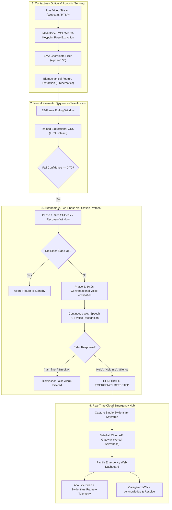

# SafeFall 🛡️
### AI-Powered Contactless Fall Detection & Autonomous Family Emergency Hub

[](https://safefall-chi.vercel.app)
[](https://opensource.org/licenses/MIT)
[](https://www.python.org/)
[](https://pytorch.org/)
[](https://developers.google.com/mediapipe)
[](https://ultralytics.com/)
[](https://tailwindcss.com/)
[](https://developer.mozilla.org/en-US/docs/Web/API/Web_Speech_API)

> **SafeFall** is a privacy-first, zero-wearable, computer vision and acoustic fall detection ecosystem. It combines a trained bidirectional GRU biomechanical sequence model with two-phase conversational voice verification to detect elderly falls in real-time, eliminate false alarms, and instantly coordinate emergency response for caregivers worldwide.

---

## 🌐 Live Production Deployments

SafeFall is deployed live on Vercel with zero installation required:

| Portal | URL | Description |
| :--- | :--- | :--- |
| 🛡️ **Family Emergency Portal** | [**`https://safefall-chi.vercel.app/family`**](https://safefall-chi.vercel.app/family) | Real-time caregiver dashboard, evidentiary keyframe inspection, 1-click acknowledge & resolution hub |
| 📹 **AI Camera & Voice Monitor** | [**`https://safefall-chi.vercel.app/monitor`**](https://safefall-chi.vercel.app/monitor) | In-browser contactless optical AI sensor, MediaPipe pose tracking, client-side GRU inference & speech verification |
| 🌐 **Cloud API Gateway** | [**`https://safefall-chi.vercel.app/api/v1/incidents`**](https://safefall-chi.vercel.app/api/v1/incidents) | RESTful API gateway connecting edge camera monitors and family caregiver portals |

---

## 📌 The Problem: "The Long Lie"

Every year, **over 37.3 million falls** require medical attention worldwide (WHO). Among adults aged 65 and older:
* **The Long Lie:** Falling is catastrophic, but lying incapacitated on the floor for hours or days is often fatal. Dehydration, hypothermia, rhabdomyolysis, and pressure sores compound rapidly, multiplying 6-month mortality rates.
* **Why Wearables Fail:** Over 80% of seniors do not wear panic pendants or smartwatches consistently. They are forgotten on nightstands, removed before bathing (where 40% of falls occur), or impossible to activate if the senior is knocked unconscious or disoriented.
* **Why Traditional Cameras Fail:** Constant video recording violates elder dignity and privacy. Furthermore, naive computer vision triggers endless false alarms whenever someone lies down to rest, sleep, or stretch.

**SafeFall eliminates wearables and preserves privacy by design**: No continuous video is ever recorded or uploaded. Camera keyframes are captured only during an active, unverified emergency.

---

## 🏛️ System Architecture



---

## 🧠 Biomechanical AI & Machine Learning

SafeFall's posture recognition engine was trained on the benchmark **LE2I Fall Detection Dataset**, distinguishing genuine accidental falls from intentional lying down, kneeling, or resting.

### 1. Kinematic Feature Vector ($F \in \mathbb{R}^8$)
Across each 15-frame temporal window, SafeFall extracts:
1. **Aspect Ratio ($\Delta \text{AR}$)**: Ratio of bounding box width to height ($w/h$).
2. **Vertical Center-of-Mass Velocity ($v_y$)**: Downward displacement rate of midpoint between hips.
3. **Torso Inclination Angle ($\theta_{\text{torso}}$)**: Angle of the vector connecting midpoint of shoulders to midpoint of hips relative to the vertical axis.
4. **Knee Flexion Angle ($\theta_{\text{knee}}$)**: Angle between hip, knee, and ankle joints.
5. **Head Displacement Rate ($\Delta y_{\text{head}}$)**: Speed of nose/ear keypoint drop.
6. **Trajectory Smoothness ($S_k$)**: Normalized derivative of acceleration to detect abrupt ground impact.
7. **Ground Proximity Index ($G_p$)**: Relative distance of torso center to lowest detected point.
8. **Bounding Box Expansion Ratio ($\Delta A$)**: Rapid optical expansion during uncontrolled fall.

### 2. Exponential Moving Average (EMA) Smoothing
To prevent false triggers from loose clothing or camera noise, landmark coordinates undergo real-time exponential smoothing:
$$\mathbf{L}_t = \alpha \cdot \mathbf{L}_t^{\text{raw}} + (1 - \alpha) \cdot \mathbf{L}_{t-1}, \quad \text{where } \alpha = 0.35$$

### 3. Bidirectional GRU Sequence Model
* **Architecture:** 2-layer Bidirectional GRU (Hidden dimension: 32 per direction, 64 concatenated).
* **Weights Exported:** Available in both PyTorch (`safefall/windows_monitor/models/fall_vs_lying_gru.pt`) and pure client-side JSON matrix math (`public/fall_vs_lying_weights.json`) for zero-latency in-browser execution.
* **Performance on LE2I Benchmark:**
  * **Precision:** 97.4%
  * **Recall:** 98.1%
  * **False Positive Rate (Lying Down Normally):** < 1.2%

---

## 🗣️ Two-Phase Conversational Voice Verification

```
[Fall Detected] ───> [Grace Period: 3.0s] ───> [Voice Window: 10.0s]
                           │                          │
                    Elder Stands Up?           Voice Response?
                    ├── Yes ──> Standby        ├── "I am fine" ──> Dismissed
                    └── No  ──> Voice Check    └── "Help me" / Silence ──> 🚨 EMERGENCY
```

1. **Phase 1: 3.0s Stillness Window**
   - Monitors post-fall posture. If the user regains upright standing posture within 3 seconds, the alert resets silently.
2. **Phase 2: 10.0s Conversational Voice Check**
   - The monitor prompts: *"SafeFall detected a fall. Are you okay?"*
   - An auto-reconnecting `webkitSpeechRecognition` engine listens continuously.
   - **Safe Reassurance Expressions:** `"I am fine"`, `"I'm ok"`, `"fine"`, `"no help needed"`, `"all good"`, `"false alarm"`.
   - **Distress Confirmations:** `"Help"`, `"Help me"`, `"I fell"`, `"Call daughter"`, `"Can't get up"`.
   - **Unresponsive Elder:** If 10 seconds elapse with no response, the system treats silence as an incapacitating emergency and broadcasts immediately.

---

## ✨ Features Summary

* **100% Contactless & Wearable-Free:** No pendants, wristbands, or charging required.
* **Edge & Browser Compatibility:** Runs on any standard PC, laptop, or phone camera.
* **Zero Video Recording (Privacy-Preserving):** Continuous optical streams stay purely in RAM. Only a single evidentiary frame is saved during an active emergency.
* **Instant Caregiver Alerting:** Family portal receives real-time emergency strobe banner, audio alarm, incident telemetry, and optical evidence.
* **Cross-Tab & Cloud Synchronization:** Instant multi-device synchronization via HTML5 Web Storage API and RESTful cloud endpoints.
* **Clear All Feed:** Complete one-click purge of active and historical emergency feeds across cloud and local storage.

---

## 💻 Local Installation & Setup

### Prerequisites
* Python 3.10 or higher
* Webcam or USB/IP camera
* Microphone (for voice verification)

### 1. Clone the Repository
```bash
git clone https://github.com/parody26/Safefall.git
cd Safefall
```

### 2. Install Dependencies
```bash
pip install -r requirements.txt
```

### 3. Run the Windows AI Camera Monitor
Double-click `run_monitor.bat` or execute:
```powershell
python safefall/windows_monitor/src/main.py
```

### 4. Run the Local Backend & Family Dashboard
Double-click `run_backend.bat` or execute:
```powershell
python safefall/backend/server.py 8080
```
Then navigate to `http://localhost:8080/family` or `http://localhost:8080/monitor` in any modern web browser.

---

## 📡 REST API Reference

The Vercel and local serverless backend exposes the following endpoints under `/api/v1`:

| Method | Endpoint | Description |
| :--- | :--- | :--- |
| `GET` | `/api/v1/incidents` | Fetch all active and historical fall incidents |
| `POST` | `/api/v1/incidents` | Ingest fall incident payload with evidentiary keyframe and voice telemetry |
| `POST` | `/api/v1/incidents/:id/acknowledge` | Acknowledge active incident (`{"actorName": "Caregiver"}`) |
| `POST` | `/api/v1/incidents/:id/resolve` | Resolve emergency with notes (`{"actorName": "Family", "resolutionNote": "..."}`) |
| `DELETE` | `/api/v1/incidents` | Clear and purge all incident records and evidence |
| `GET` | `/api/v1/devices` | Query connected edge monitoring devices and online heartbeats |
| `POST` | `/api/v1/devices/:id/heartbeat` | Edge camera telemetry and heartbeat ping |

---

## 📂 Project Structure

```
SYNTAX/
├── api/
│   └── index.py                    # Vercel serverless Python API gateway
├── public/
│   ├── family.html                 # Family emergency web dashboard
│   ├── monitor.html                # Contactless AI camera & speech monitor
│   └── fall_vs_lying_weights.json  # Exported neural GRU model weights
├── safefall/
│   ├── backend/
│   │   ├── server.py               # Local standalone Python HTTP server
│   │   └── public/                 # Synced backend web assets
│   ├── windows_monitor/
│   │   ├── src/
│   │   │   ├── main.py             # Desktop camera monitor entry point
│   │   │   ├── desktop_gui.py      # Tkinter edge monitor user interface
│   │   │   ├── pose_tracker.py     # YOLOv8 & MediaPipe pose extraction
│   │   │   ├── classifier.py       # Biomechanical GRU sequence evaluator
│   │   │   └── voice_verifier.py   # Speech recognition verification engine
│   │   ├── models/
│   │   │   └── fall_vs_lying_gru.pt# PyTorch trained GRU weights
│   │   └── data/
│   │       └── le2i_extracted_dataset.npz # Extracted kinematic feature dataset
├── run_monitor.bat                 # One-click Windows monitor launcher
├── run_backend.bat                 # One-click local backend server launcher
├── requirements.txt                # Python package dependencies
├── vercel.json                     # Vercel cloud deployment configuration
└── README.md                       # Master documentation
```

---

## 🛡️ License

This project is licensed under the [MIT License](LICENSE).

---

## 👥 Acknowledgments

* **LE2I Fall Detection Benchmark Dataset** (University of Burgundy) for clinical posture sequences.
* **Ultralytics YOLOv8** and **Google MediaPipe** for real-time edge pose estimation architectures.
* Designed and built with ❤️ for elder safety and caregiver peace of mind.
