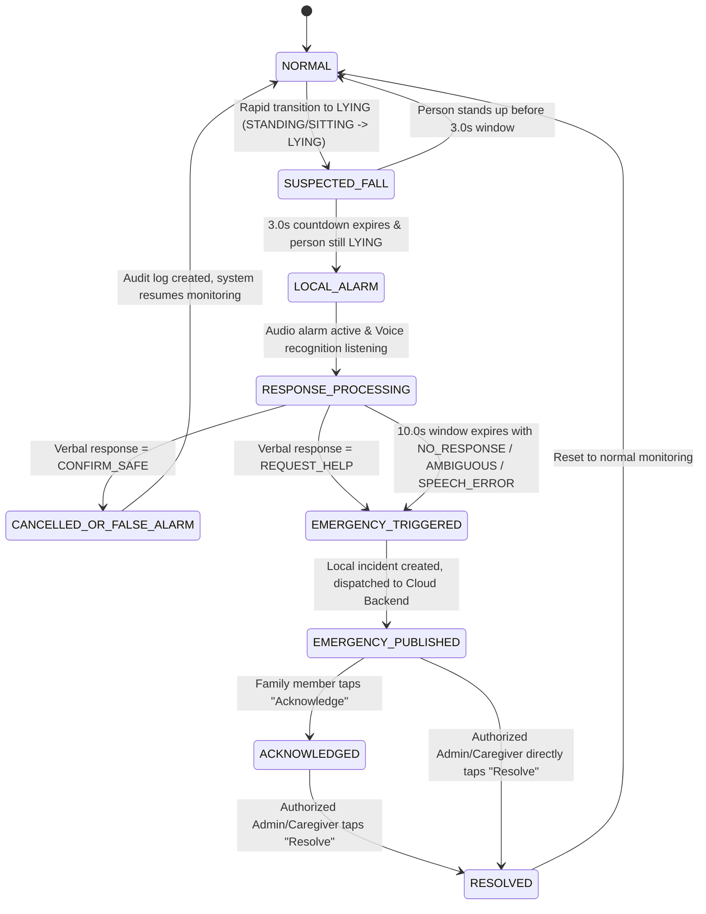

# SafeFall Emergency State Machine Specification

## 1. State Machine Overview
The SafeFall Emergency State Machine handles the life cycle of suspected falls, local alarms, verbal interaction, automatic escalation, backend synchronization, family acknowledgement, and authorized resolution.

## 2. Formal States Description

| State | Name | Description | Transitions |
|---|---|---|---|
| **A** | `NORMAL` | Standard surveillance state. Periodically samples frames, extracts landmarks, updates rolling temporal window. | $\to$ `SUSPECTED_FALL` on temporal fall detection criteria. |
| **B** | `SUSPECTED_FALL` | Candidate fall criteria met. Starts monotonic 3.0s timer. Retains evidentiary frame(s) in memory. | $\to$ `LOCAL_ALARM` if timer reaches 3.0s and posture remains LYING. $\to$ `NORMAL` if person recovers to STANDING/SITTING before 3.0s. |
| **C** | `LOCAL_ALARM` | Starts audible repeating "beep-beep" alarm on device speaker. Activates visual strobe/warning alert on monitor screen. | Immediately enters `RESPONSE_PROCESSING`. |
| **D** | `RESPONSE_PROCESSING` | Prompts user verbally ("Are you okay?"). Opens microphone for speech-to-text. Evaluates intent for up to 10.0 seconds. | $\to$ `CANCELLED_OR_FALSE_ALARM` if `CONFIRM_SAFE`. $\to$ `EMERGENCY_TRIGGERED` immediately if `REQUEST_HELP`. $\to$ `EMERGENCY_TRIGGERED` if 10.0s timeout reached without verified safety. |
| **E** | `CANCELLED_OR_FALSE_ALARM` | Silence alarm immediately. Record audit entry (marked as false alarm / user confirmed safe). No family panic alert sent. | $\to$ `NORMAL` (monitoring resumes). |
| **F** | `EMERGENCY_TRIGGERED` | Immediate local incident created with unique UUID. Evidence frame persisted to secure local incident queue. | $\to$ `EMERGENCY_PUBLISHED`. |
| **G** | `EMERGENCY_PUBLISHED` | Published to Firestore / Backend API. Push notifications sent to family devices. Family UI shows critical emergency banner. | $\to$ `ACKNOWLEDGED` on family acknowledge. $\to$ `RESOLVED` on authorized family resolve. |
| **H** | `ACKNOWLEDGED` | Family member acknowledged seeing the alert. Timestamp and member UID recorded. Does **NOT** stop alarm or mark safe. | $\to$ `RESOLVED` when physical check completed. |
| **I** | `RESOLVED` | Authorized caregiver/admin verifies person is safe or emergency handled, enters optional resolution note. System returns to normal. | $\to$ `NORMAL`. |

## 3. Verbal Intent Taxonomy & Prioritization Rules
When analyzing verbal transcripts from the microphone:
1. **`REQUEST_HELP`** takes absolute precedence over `CONFIRM_SAFE` in contradictory phrases:
   - Example: *"I fell, help me, I think I'm okay"* $\to$ Classify as **`REQUEST_HELP`**.
2. **`CONFIRM_SAFE`** requires clear, unambiguous confirmation:
   - *"I'm okay"*, *"I am fine"*, *"I'm fine"*, *"I'm good"*, *"No problem"*, *"Don't worry"*, *"I just tripped, I'm okay"*, *"I don't need help"*.
3. **`REQUEST_HELP`** examples:
   - *"Help"*, *"Help me"*, *"Please help"*, *"I need help"*, *"Call someone"*, *"Call my son"*, *"Call my daughter"*, *"Call an ambulance"*, *"Emergency"*.
4. **`AMBIGUOUS / NO_RESPONSE / SPEECH_ERROR`**:
   - Inaudible murmurs, silence, background noise, or speech engine failure trigger emergency escalation after 10.0s timeout. **Fail-safe principle**: Never assume a silent or groaning person is safe!
